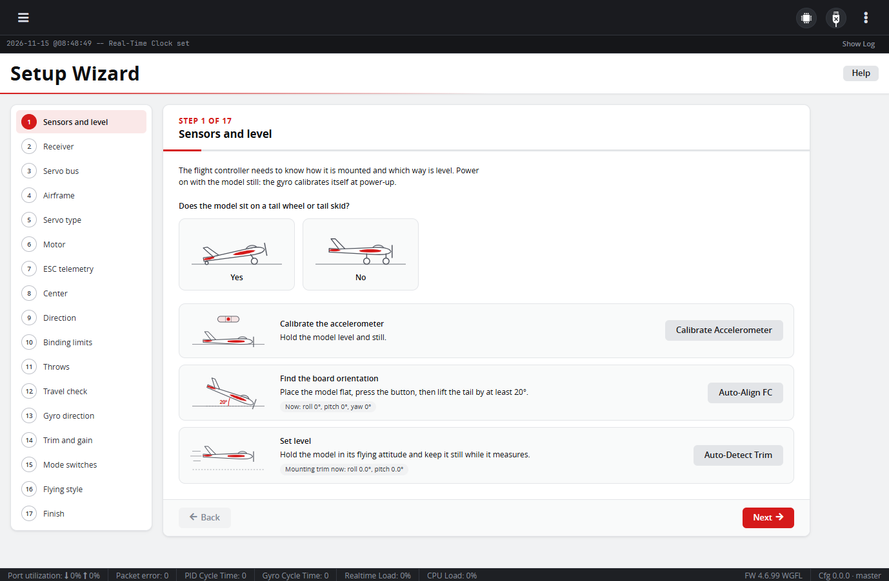
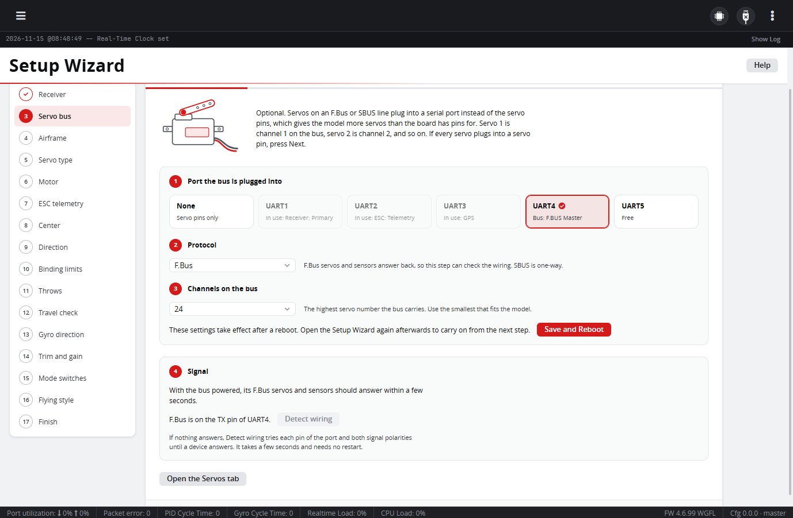
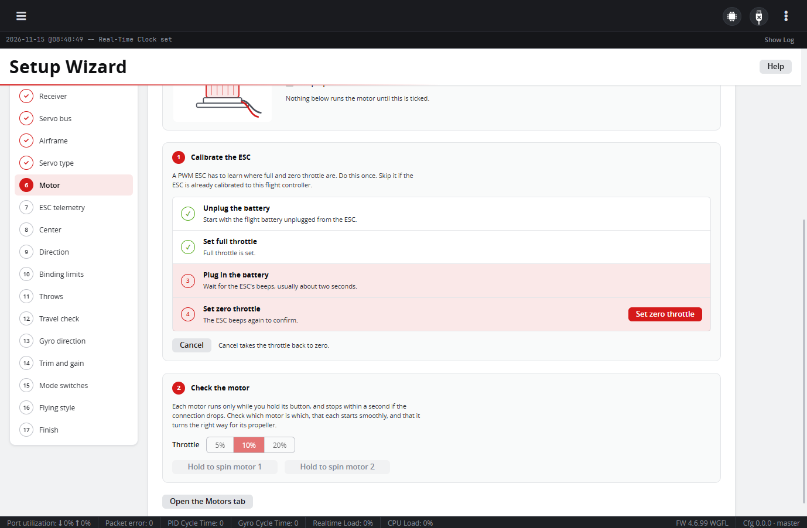
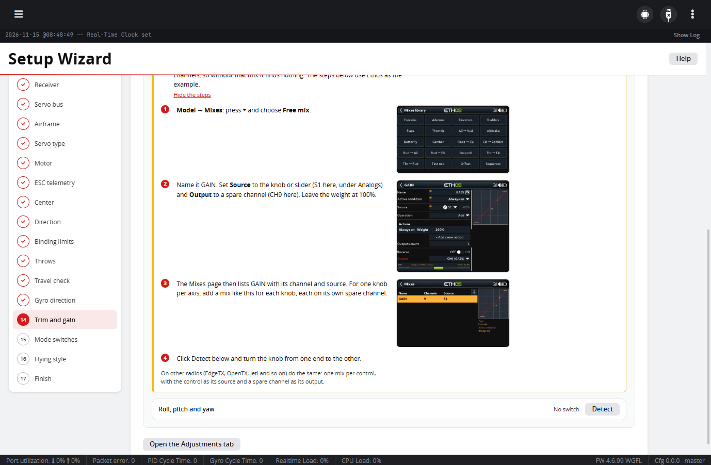

# Set Up Your Aircraft

The **Setup Wizard** in the Configurator takes a flight controller that has
been flashed and connected through to a model that is ready for its first
flight. It asks one thing at a time, in the order the settings depend on each
other, and checks each answer on the model as you go.

Open it from the **Setup Wizard** tab once you are
[connected](first-connection.md). The Help button on that tab opens this page.

!!! warning "Take the propeller off"
    Several steps move the control surfaces, and the Motor step runs the
    motor. Do the whole wizard with the propeller removed. Read
    [Safety](safety.md) first.

## How it works

- **The steps are in order.** Each one relies on the ones before it: the
  airframe says which servo is which surface, limits come before throws, and
  throws before the tune. You can jump to any step from the list on the left.
- **Changes reach the model straight away**, so a surface moves as you adjust
  it. **Save and continue** writes them to the flight controller's memory and
  moves on. A step you did not change shows **Next**.
- **Some settings only take effect after a restart**: a port, a protocol, the
  servo update rate. A step that changes one shows **Save and Reboot**. The
  wizard reopens on the same step when the flight controller is back, so you
  can check the result before moving on.
- **The model can't be armed by the wizard.** While it is armed, the wizard
  stops moving anything and says so.

The same wizard is in the [Ethos Lua Suite](../ethos-suite/index.md), under
**Tools → Setup Wizard**, so setup can also be done from a FrSky radio. Receiver port and protocol setup is
only in the Configurator, because the radio talks to the flight controller
through the receiver.

## The steps

| Step | What you do |
| --- | --- |
| 1. Sensors and level | Calibrate the accelerometer, find the board orientation and set which way is level. Power on with the model still: the gyro calibrates itself at power-up. |
| 2. Receiver | Say which port the receiver is plugged into and which protocol it uses, then check every stick reaches the flight controller the right way round. |
| 3. Servo bus | Optional. For servos on an F.Bus or SBUS line. See [Servo bus](#servo-bus). |
| 4. Airframe | Choose the model type and its options. This decides which servo drives which surface. |
| 5. Servo type | Analog (50 Hz) or digital (333 Hz) servos. One update rate for every servo output. |
| 6. Motor | Choose how the flight controller talks to the ESC, calibrate a PWM ESC and check each motor runs. See [Motor](#motor). |
| 7. ESC telemetry | Optional. If the ESC sends telemetry: its protocol and port, wiring detection, and whether battery voltage, current and motor RPM come from it. |
| 8. Center | The surfaces are held at center. Set each horn and linkage so the surface is close to neutral, then fine-tune the center. |
| 9. Direction | The wizard moves one axis at a time and you confirm each surface goes the right way. |
| 10. Binding limits | Find how far each servo can move before the surface or linkage binds. |
| 11. Throws | Set how far each surface moves at full stick, with a throw meter or ruler on the surface. |
| 12. Travel check | See how far each surface goes with full stick on every axis at once, compared with its limits. |
| 13. Gyro direction | Tilt the model by hand: the surfaces should push back toward level. |
| 14. Trim and gain | Choose how you will trim, and put the stabilizer gain on a knob. See [Radio mixes](#radio-mixes-for-a-gain-knob-and-mode-switches). |
| 15. Mode switches | Put ARM, and any other modes you want, on switches. Only ARM is required. |
| 16. Flying style | Trainer, Sport or 3D: starting rates and stabilizer behaviour to tune from. |
| 17. Finish | A summary of what the wizard set, and the checks before the first flight. |

## Servo bus

A flight controller has a fixed number of servo pins. Servos on an **F.Bus**
or **SBUS** line plug into a serial port instead, which gives the model more
servos than the board has pins for. Servo 1 is channel 1 on the bus, servo 2
is channel 2, and so on, and a servo can be on a pin and on the bus at once.

1. **Port.** Choose **None** to use the servo pins only, or a free port. On
   boards with a connector labelled S.BUS, that port is marked as suggested.
2. **Protocol.** F.Bus or SBUS. A newly chosen port starts on F.Bus.
3. **Channels.** The highest servo number the bus carries. Use the smallest
   that fits the model.
4. **Save and Reboot.** The port is opened when the flight controller starts.
5. **Signal.** With the bus powered, the step shows how many F.Bus servos and
   sensors are answering. If nothing answers, press **Detect wiring**: the
   flight controller tries each pin of the port and both signal polarities
   until a device answers. A wiring it finds is in use at once and only needs
   saving.

F.Bus runs on a port's TX pin. A connector labelled S.BUS or RX is the RX
pin, so the wizard switches F.Bus to that pin when you choose such a port.
You never set the pin swap yourself.

SBUS is one-way: nothing answers on it, so check it in the later steps, where
each servo is moved.

!!! note "A bus servo must be on the right channel"
    A servo on the bus listens to one channel number, set in the servo
    itself. If a bus servo follows the sticks but ignores the Center or
    Direction steps, check which channel it is set to: it may be following a
    different servo number than you expect. For FrSky servos see
    [FrSky Servos](../setup/frsky-servos.md).

Detect wiring needs firmware with the F.Bus wiring trial. On older firmware
the step offers **Use the other pin** instead, which needs a restart for each
try.

## Motor

Choose **Standard PWM**, **DShot150** or **DShot300**, or another protocol
from the **Other** list. A change ends with **Save and Reboot**. The checks
below appear once the protocol in use is the one chosen.

### Calibrate a PWM ESC

A PWM ESC has to learn where full and zero throttle are. Do this once. Skip
it if the ESC is already calibrated to this flight controller. DShot has no
range to learn, so the card only appears for Standard PWM.

Tick **The propeller is removed**, then follow the four stages in order:

1. **Unplug the battery** from the ESC and tick the box.
2. **Set full throttle.** The output takes about five seconds to reach full
   and then stays there.
3. **Plug in the battery** and wait for the ESC's beeps, usually about two
   seconds.
4. **Set zero throttle.** The ESC beeps again to confirm.

**Cancel** takes the throttle back to zero at any point. If the ESC did not
confirm, unplug the battery and calibrate again.

### Check the motor

Pick a throttle (5, 10 or 20 %) and hold the button to spin. The motor runs
only while the button is held, and stops within a second if the connection
drops. On a model with more than one motor there is a button for each, so you
can see which motor is which before differential thrust relies on it.

If a motor turns the wrong way, swap any two of its three wires, or reverse it
in the ESC's settings.

### SRXL2 and Castle ESCs

- **SRXL2** (Spektrum Smart ESCs): the ESC takes its throttle and sends its
  telemetry on one signal wire, and that wire goes to a **serial port**, not
  to the motor output. Choosing SRXL2 asks which port it is plugged into. See
  [Motors](../configurator/tabs/motors.md#srxl2-esc).
- **Castle Link**: wired like Standard PWM, on the motor output. It needs no
  serial port; its telemetry comes back on the same wire. See
  [Castle ESC Telemetry](../reference/castle-esc-telemetry.md).

## Radio mixes for a gain knob and mode switches

A knob or a switch does nothing until **a mix on the radio puts it on a
channel**. The wizard's **Detect** and **Assign** buttons watch the channels,
so without that mix they find nothing. This is the most common reason the gain
knob or a mode switch "doesn't work".

Both steps show how, with Ethos as the example. On the radio:

1. **Model → Mixes**: press **+** and choose **Free mix**.
2. Name it (GAIN, ARM and so on). Set **Source** to the knob, slider or
   switch, and **Output** to a spare channel. Leave the weight at 100 %.
3. Do the same for each control, each on its own spare channel. One
   3-position switch can carry two modes.

Then in the wizard, click **Detect** and turn the knob from end to end, or
press **Assign** and flick the switch to its on position.

On other radios (EdgeTX, OpenTX, Jeti and so on) do the same: one mix per
control, with the control as its source and a spare channel as its output.

The trim options on the Trim and gain step have their own radio guide on the
step itself.

## After the wizard

- Take a [backup](backup-and-restore.md) before you start tuning.
- Set up your receiver's failsafe and check it: see [Safety](safety.md).
- Everything the wizard sets can be changed later on its own tab:
  [Servos](../configurator/tabs/servos.md),
  [Mixer](../configurator/tabs/mixer.md),
  [Motors](../configurator/tabs/motors.md),
  [Modes](../configurator/tabs/auxiliary.md) and
  [Adjustments](../configurator/tabs/adjustments.md).
