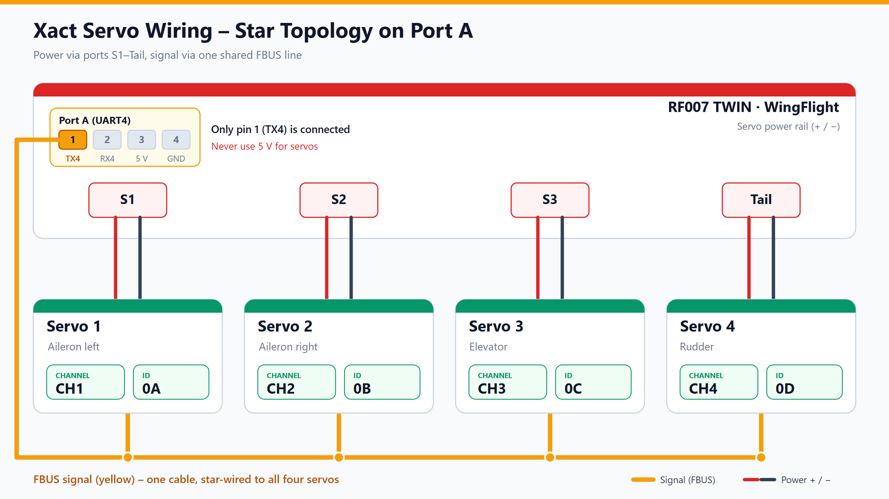
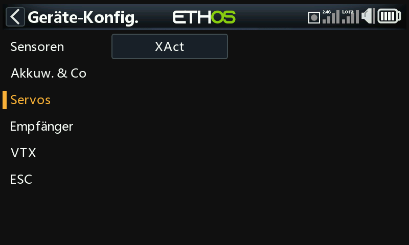
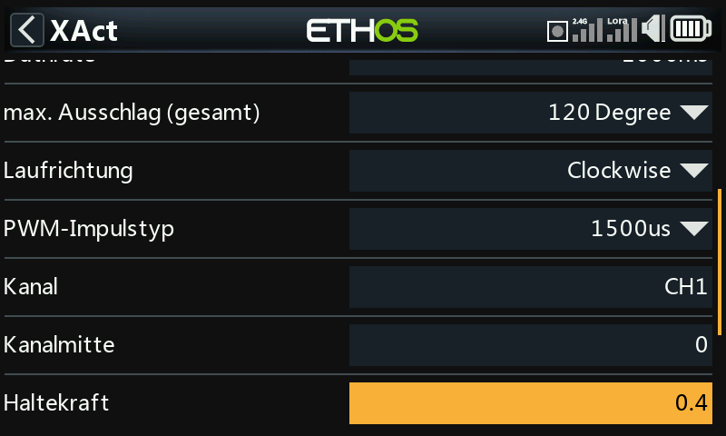
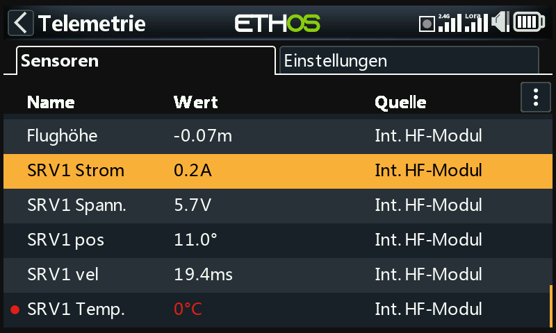

# FrSky Servos

FrSky XACT servos can run on a single **F.Bus** wire. That one wire carries the
control data from the flight controller to the servos and their telemetry
back. Power comes from the servo ports as usual.

This guide covers the bus wiring, programming each servo, forwarding its
telemetry to the radio, and the checks before the first flight. The settings
themselves are explained on their own pages, linked below.

!!! danger "Propeller off"
    Remove the propeller, or keep the motor disconnected, until every servo has
    passed the checks in [section 6](#6-checks-before-the-first-flight).

!!! warning "Program one servo at a time"
    FrSky servos ship with the same Physical ID (`0A`, sometimes `0C`) and
    channel `CH1`. Two servos with the same ID on the bus answer each other's
    telemetry requests, and a save can overwrite all of them at once. Connect
    each new servo alone, assign its ID and channel, save it, and only then
    join it to the bus.

## What you need

- A flight controller with a free UART that can be set to **FBUS Master**
  (function `FBUS_OUT`, see [Configuration](../configurator/tabs/configuration.md)).
  The pin mapping in this guide is taken from the VANTAC RF007 TWIN drawing; a
  WingFlight target for that board is not in the repository, so check your
  board's pinout before wiring.
- Four XACT servos for two ailerons, the elevator and the rudder. They match the
  default mixer, see [section 5](#5-bus-servos-and-the-mixer).
- The [Configurator](../configurator/index.md) and a transmitter with the
  FrSky Ethos XAct menu, or the Configurator only, for the settings in section 3.

## 1. Wiring

Each servo uses two connections:

- **Power** comes from the servo port on the flight controller, through the
  usual red (+) and black (−) lead. Servo 1 (left aileron) goes to **S1**,
  servo 2 (right aileron) to **S2**, servo 3 (elevator) to **S3**, and servo 4
  (rudder) to **Tail** (the S4 output). The ports share one power rail on the
  RF007 TWIN.
- **Signal** is the F.Bus wire. Only **pin 1 (TX4)** of Port A is connected on
  the RF007 TWIN. The yellow signal wires of all servos join at one star point,
  which is fed from that pin.



!!! danger "Power servos only from the servo ports"
    On the RF007 TWIN, leave Port A pins 2 to 4 unconnected. Do not run a servo
    from any Port A pin, including the 5 V pin shown in the wiring diagram.

Use the same plugs and servo leads you would for PWM. The signal pin of the
servo ports is not used, because the servos take their control data from the
F.Bus wire.

## 2. Programming the servos

Each servo needs two addresses, set one servo at a time:

| Servo | Control surface | Channel | Physical ID (hex) | Physical ID (CLI, decimal) |
| :-- | :-- | :-- | :-- | :-- |
| 1 | Aileron left | `CH1` | `0A` | 10 |
| 2 | Aileron right | `CH2` | `0B` | 11 |
| 3 | Elevator | `CH3` | `0C` | 12 |
| 4 | Rudder | `CH4` | `0D` | 13 |

- **Channel** says which bus channel the servo answers to. Bus channel N
  mirrors PWM output N by default (see [Clone PWM outputs to bus servos](../configurator/tabs/servos.md#clone-pwm-outputs-to-bus-servos)),
  so channel `CHn` drives the surface on output `Sn`.
- **Physical ID** is the unique bus address used for telemetry. The valid
  range is `00` to `1A`.

!!! warning "Check the total travel and the arm angles before installation"
    A Rotorflight test on a helicopter found that with **120°** total travel the
    angles did not match the servo positions, and that **180°** matched. The
    WingFlight firmware accepts 120°, 90° and 180° for XACT servos
    (`src/main/drivers/fbus_xact.h:36`). This result is not verified for control
    surfaces. Set the total travel to what your linkage needs, and measure each
    arm angle **before** the servo is installed in the model. Endpoints are
    described in [Servos](../configurator/tabs/servos.md#endpoints-and-scale).

### 2.1 Configurator

The WingFlight Configurator documentation does not describe a bus-servo
programming tab for XACT servos. This route is **not verified** for WingFlight.
Use the Ethos route in section 2.2.

### 2.2 Transmitter (Ethos)

FrSky's XAct Lua script adds a servo menu to Ethos radios under
**System → Device Config**. Install it with the FrSky Suite (2.0 or later),
under **Lua library**. It programs a servo that is connected directly to the
transmitter or receiver. Whether it can also reach a servo on the flight
controller's Port A is **not verified** for this guide, so use the Configurator
route for bus servos once that route is documented.

The entry is under **System → Device config → Servos → XAct**.


*Ethos Device config → Servos → XAct (German UI).*

The table gives the values used on the test servos as a starting point:

| Setting | Value |
| :-- | :-- |
| Physical ID | `0A` to `0D`, one per servo |
| Application ID | `6800` (leave unchanged) |
| Data rate | `1000 ms` |
| Max. travel, total | see the warning in section 2 |
| Direction | `Clockwise` |
| Working range | `Angle mode` (not continuous rotation) |
| Channel | `CH1` to `CH4` |
| Channel center | `0` |
| Holding force | `0.4` |
| Smoothing | `1` |
| Dead zone | `3` |


*Ethos XAct menu, read from the servo (German UI).*


*Ethos XAct parameters, read from the servo (German UI). The photo shows the
previous 120° setting; use the value from the warning in section 2.*

## 3. Serial port and telemetry in the Configurator

1. Open the [Configuration](../configurator/tabs/configuration.md) tab.
2. Assign the UART that carries the servos to **FBUS Master**.
3. Save the configuration.

The bus servos are read by the master and listed on the
[FBUS/S.Port Sensors](../configurator/tabs/fbus-sensors.md) tab. Each servo
should appear there with its physical ID once it answers on the bus.

## 4. Forwarding servo telemetry to the radio

The flight controller forwards a sensor's telemetry to the radio only when it is
set to **Forwarded**. Up to **8 sensors** can be forwarded at once. Out of the
box, none are forwarded (`src/main/pg/fbus_master.c:40`).

1. Set the **receiver** protocol to F.Port, F.Port2 or FBUS on the
   [Receiver](../configurator/tabs/receiver.md) tab. The Forwarded toggle is only
   enabled for these protocols, because the forwarding uses the receiver's
   telemetry return channel.
2. On the [FBUS/S.Port Sensors](../configurator/tabs/fbus-sensors.md#forwarding)
   tab, turn **Forwarded** on for the four servos (`0A` to `0D`). The change
   takes effect at once, without a reboot.

The same list can be set in the CLI with the key `fbus_master_forwarded_sensors`
(`src/main/cli/settings.c:1447`). Decimal IDs `10, 11, 12, 13` are the servos
`0A` to `0D`:

```text
set fbus_master_forwarded_sensors = 10, 11, 12, 13, 255, 255, 255, 255
save
```

`255` means an unused slot. Check the result with the `fbus_sensors` command
(`src/main/cli/cli.c:6769`) and its **Forwarded** column:

```text
fbus_sensors
```

On the transmitter, run **Model → Telemetry → Discover sensors**. The radio then
lists the sensors of the servo:



*Ethos telemetry page after discovery, with live values from the servo
(German UI).*

The flight controller decodes three values from the servo frame: current,
voltage and temperature (`fbusServoConvertData` in
`src/main/drivers/fbus_sensor.c:187-192`, called at `fbus_sensor.c:533-535`).

## 5. Bus servos and the mixer

The default mixer of a new model is a glider layout (`src/main/pg/mixer.c:55-79`):

- **S1** left aileron (`STABILIZED_ROLL`, weight +1000)
- **S2** right aileron (`STABILIZED_ROLL`, weight −1000, for differential)
- **S3** elevator (`STABILIZED_PITCH`, weight +1000)
- **S4** rudder (`STABILIZED_YAW`, weight +1000)

With **Clone PWM outputs to bus servos** on, which is the default
(`src/main/pg/bus_servo.c:37`), bus channels 1 to 4 mirror S1 to S4. The XACT
servos on the bus therefore receive their surface positions without any extra
rule. The [Servos](../configurator/tabs/servos.md#bus-servos) tab shows the bus
table below the PWM table.

- Use the [Mixer](../configurator/tabs/mixer.md) tab, or the Mixer Setup Wizard,
  for a different wing layout.
- If a surface moves the wrong way, use **Reverse** on the Servos tab, or check
  the rule polarity on the Mixer tab.

## 6. Checks before the first flight

Before the first flight, check the arm angles as the warning in
[section 2](#2-programming-the-servos) describes. Then run these with the motor
disarmed and the propeller off:

1. **Surface direction.** Move each stick and check that each surface moves in the
   direction its mixer rule defines. Correct a reversed surface with **Reverse**
   on the Servos tab, not by changing the rule (see [section 5](#5-bus-servos-and-the-mixer)).
2. **Stabilization response.** Tilt the model by hand around each axis. The
   surfaces must respond as the mixer defines. If a surface responds in the wrong
   direction, check the rule polarity and **Reverse**.
3. **Full travel.** Move each control to full deflection and watch the servo
   current in telemetry. A large rise at one point means the linkage binds. Reduce
   the travel with Min/Max on the Servos tab.
4. **Power-on.** Power on with all servos connected. They must move to neutral
   smoothly and must not jerk.

## Troubleshooting

| Problem | Try |
| :-- | :-- |
| Servos do not respond | Check that the UART is set to FBUS Master, the single signal wire, and that each servo is powered from its servo port. |
| Two servos appear as one | Two servos share an ID. Re-program them one at a time. |
| Servo is listed on FBUS/S.Port Sensors, but **Forwarded** is off | Turn **Forwarded** on. The receiver must be F.Port, F.Port2 or FBUS. |
| Telemetry shows nothing on the radio | Run **Discover sensors** on the transmitter again. |

## Not verified for WingFlight

- The Port A pin mapping and the pin 5 V warning. They come from the RF007 TWIN
  drawing, and no WingFlight target for that board is in the repository.
- The Configurator route for XACT servos (section 2.1).
- The cause of the 120° versus 180° finding. It comes from a helicopter test with
  Rotorflight and has not been checked against WingFlight's servo angle mapping.
- Whether the Ethos XAct menu reaches a servo on the flight controller's Port A
  (section 2.2).
